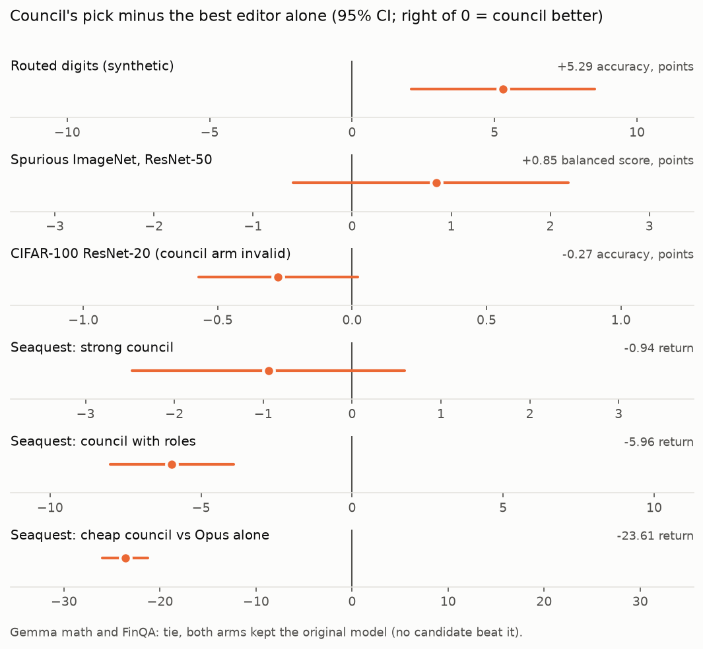
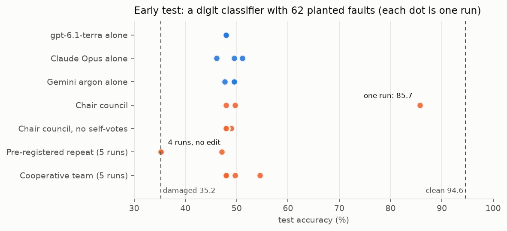
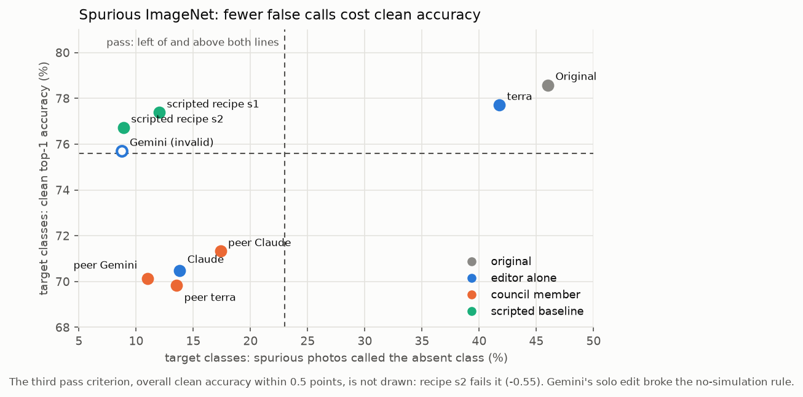
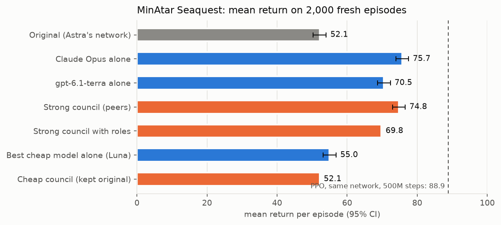
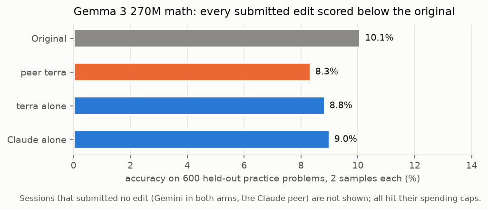

# Findings

What we measured with wsplab, November 2026, on one laptop (16 GB GPU) with real LLM editors. These are small,
budgeted experiments: read them as evidence about this setup, not as benchmarks. Each experiment has a folder under
[`experiments/`](experiments/) with its code, plans, result files and exact commands. Negative results are included.

**Contents:** [Summary](#summary) · [Reproducing the paper](#reproducing-the-paper) ·
[Single-editor runs](#single-editor-runs) · [Councils](#councils) ·
[Looking for a genuine hard task](#looking-for-a-genuine-hard-task) · [Spurious ImageNet](#spurious-imagenet-resnet-50) ·
[Seaquest](#minatar-seaquest) · [Gemma math](#gemma-3-270m-math) · [Rules and audits](#rules-and-audits) · [Costs](#costs)

## Summary

1. **wsplab reproduces the paper's measurements.** The authors' released patches rebuild bit for bit, the driver
   replays their sessions' prompts byte for byte, and re-measuring their 50-pass Qwen edit gave +48.4 points against
   their logged +39.1. We didn't reproduce the discovery of such an edit at laptop scale.
2. **Weight editing works when the failure is a behaviour the network can be steered out of.** Every strong editor
   that tested an edit lifted the Seaquest policy Astra wrote in the paper from 52 to 70–76, changing 24–32 of its
   20,486 weights. Most editors cut ResNet-50's false "spurious cue" predictions from 46% to 11–17%.
3. **It doesn't add missing capability.** Gemma 3 270M's math, Qwen3-0.6B's Bengali and Swahili, and CIFAR-100
   accuracy didn't move.
4. **A short scripted recipe can match an LLM editor.** On Spurious ImageNet, a two-line rule re-implemented from a
   published description beat every valid LLM edit. The reusable value is often the diagnosis, not the weights.
5. **Councils of peers lift their weakest member but didn't beat their strongest on any natural task.** A council of
   cheap models found nothing. Giving members fixed roles made things worse. One editor stays the default.
6. **Rules need audits.** Some models compute the network's outputs in their kernel to score candidate edits, which
   the method forbids. Gemini did this in five sessions across four tasks. Every run here was audited by hand before
   its evaluation was read.

<picture>
  <source media="(prefers-color-scheme: dark)" srcset="docs/figures/council-vs-solo-dark.png">
  
</picture>

## Reproducing the paper

Folder: [`experiments/00_paper_conformance`](experiments/00_paper_conformance). These checks need no LLM calls.

| Check | Result |
|---|---|
| Rebuild the released p10c, p25c and p50c Qwen patches | Every `edited_sha256` matches |
| Replay the p50c and g50b sessions through wsplab's driver | All 275 prompts match byte for byte; final counters match |
| Recompute the paper's `merged.json` score files | Exact |
| Re-measure the released 50-pass edit (64 practice problems) | +48.4 ± 6.3 points, against the logged +39.1 ± 6.2 |

## Single-editor runs

Folders: [`01_first_live_runs`](experiments/01_first_live_runs) and [`02_astra_50_passes`](experiments/02_astra_50_passes).

| Test | Editor | Passes | Verdict | Before → after | Cost |
|---|---|---:|---|---|---:|
| Digit classifier, two output rows swapped | gpt-6-sol | 3 | `confirmed` | 82.1% → 98.2% (the clean score) | $0.27 |
| Digit classifier, 5 flipped signs | a coding agent, from the skill alone | 6 | `confirmed` | 86.5% → 95.0% | no API cost |
| Gemma 3 270M, MATH-500 subset | gpt-6-sol | 5 | `not_significant` | 8.0% → 6.5% | $0.40 |
| Qwen3.5-0.8B, MATH-500 subset | gpt-6-astra | 12 | `not_significant` | 4.0% → 10.0% | $2.93 |
| Qwen3.5-0.8B, 200 MATH-500 problems | gpt-6-astra | 50 | `not_significant` | 9.5% → 14.0% | ≤ $15 |

The 50-pass run gained +4.5 points against a gate of twice the standard error, which was 4.55: it missed by 0.05
points (paired exact test p = 0.078). A random edit of the same size came close to the 12-pass edit's gain. These
runs used 8,192-token answers and 100–200 problems; the paper used 32,768 tokens and the full benchmark.

## Councils

A council runs several editors as peers: each edits its own copy and sees the others' work after every step, and the
best candidate on a held-out selection set wins (see [docs/council.md](docs/council.md)). We compared it, at matched
budgets, with the same models working alone.

**Early digit tasks** ([`03_early_councils`](experiments/03_early_councils)). On a two-fault classifier, every arm
fixed the first fault. Neither a chair council voting on scripts nor a vote on finished weights beat its best member,
and both cost more. On a classifier with 62 planted faults, one council run reached 85.7% where every solo run stayed
near 49%. The same setup, re-run five times under a test fixed in advance, reached 70% in 0 of 5 runs.

<picture>
  <source media="(prefers-color-scheme: dark)" srcset="docs/figures/early-hard-digits-dark.png">
  
</picture>

**Routed digits** ([`04_routed_digits`](experiments/04_routed_digits)). This is a synthetic task built so separate
repairs add up: ten digit detectors, eight of them damaged. On a fresh seed, the gpt-6.1-terra + Claude peers' pick
scored **88.8%**, against 83.5% for Claude alone and 78.8% for terra alone (damaged: 50%). That's +5.3 ± 1.6 points
over the best solo, on 340 held-out queries. It is the only council win, and it is one seed on a task designed for
it. An earlier three-provider pilot scored 91.8% but was disqualified: Gemini replayed modified layers in Python.

## Looking for a genuine hard task

We then looked for a natural weakness, with no planted faults, before spending on councils.

| Task | Model | Baseline | What we found |
|---|---|---|---|
| CIFAR-100 ([`05`](experiments/05_cifar100)) | public ResNet-20 | 68.9% (matches the published 68.83%) | Council 68.5%, best solo 68.8%: no gain. The council arm was invalid (Gemini simulated layers). $9.35 |
| MGSM-Rev2 ([`06`](experiments/06_mgsm)) | Qwen3-0.6B | English 78–84%, Bengali 9–22%, Swahili 3–6% | A real gap, but translation probes showed the model doesn't understand the question. Not a fixable fault; no paid run |
| HotpotQA ([`07`](experiments/07_hotpotqa)) | Qwen3-0.6B | 50% full context vs 62.5% with gold passages (thinking on) | Gap too small to use |
| FinQA ([`08`](experiments/08_finqa)) | Qwen3-0.6B | 53.1% (thinking on, 32 questions) | Two council runs: first the editors tested no edits; then 12 required edits were tested and none survived its confirmation. 32 items with one sample each can't detect realistic effects. $7.99 |

## Spurious ImageNet, ResNet-50

Folder: [`09_spurious_imagenet`](experiments/09_spurious_imagenet).
- **The failure:** the unmodified torchvision ResNet-50 labels photos of a class's usual context (water for "snorkel",
  ice for "puck") as that class, even when the object is absent.
- **The setup:** a council of OpenAI, Claude and Gemini, against the same three working alone. Evaluation used
  28,325 photos.
- **The pass bar:** halve the false calls, while losing at most 3 points of clean accuracy on the target classes and
  0.5 points overall.

<picture>
  <source media="(prefers-color-scheme: dark)" srcset="docs/figures/spurious-imagenet-dark.png">
  
</picture>

- **The editors that made a real edit found the right idea:** damp the final-layer connections from context channels.
  That cut false calls from 46% to 11–17%, but every such valid edit lost 7–9 points of clean accuracy on the same
  classes. terra alone barely edited (41.8%).
- **The re-implemented published recipe kept clean accuracy and beat every valid LLM edit.** It beat the council's
  pick by 1.9 points of balanced score (class-clustered 95% CI −3.4 to −0.5).
- **The council led the best solo by +0.9 points,** inside class-level noise (CI −0.6 to +2.2).
- **The only LLM edit that passed the bar was disqualified:** Gemini solo fitted weights and scored candidates in its
  kernel.
- **Cost:** $7.15.

## MinAtar Seaquest

Folder: [`10_seaquest`](experiments/10_seaquest).
- **The task:** improve the Seaquest policy network GPT-6 Astra wrote, one-shot, in the paper. It scored 52.1 on our
  2,000 fresh evaluation episodes; PPO on the same 600-32-32-6 architecture reaches 88.9.
- **The setup:** 8 forward passes per editor; an edit budget of 1,024 weights.

<picture>
  <source media="(prefers-color-scheme: dark)" srcset="docs/figures/seaquest-dark.png">
  
</picture>

| Arm | Return | vs Claude Opus alone | Cost |
|---|---:|---:|---:|
| Original (Astra's network) | 52.1 | | |
| Claude Opus alone | **75.7** | | |
| Strong council (terra, Claude, Gemini as peers) | 74.8 | −0.9 ± 0.8 | $3.92 for the arm |
| Strong council with fixed roles (proposer, critic, analyst) | 69.8 | −6.0 ± 1.0 | $4.39 |
| Cheap council (gpt-6-luna, Haiku 5.5, Gemini 3.8 Flash) | 52.1 (no candidate beat the original) | −23.6 | $1.67 |
| Best cheap model alone (Luna) | 55.0 | | |

- **What the edits did:** they strengthened the circuit's "danger two rows ahead" signal and added a gated
  escape-upward unit. Episodes lasted about 43% longer.
- **Specificity:** same-size random edits destroyed the policy (scores near 0).
- **Sharing:** it lifted terra from 70.5 alone to 74.8 as a peer, but no council beat Claude alone.
- **Cheap models:** without a strong member, their edits broke the policy (3.8 and 6.8).
- **Roles:** the critic's and analyst's long reports filled the proposer's context, and it stopped after 5 of its 8
  passes.

## Gemma 3 270M math

Folder: [`11_gemma_math`](experiments/11_gemma_math). In the paper's follow-up, Astra moved Gemma's MATH-500 score
only from 6.8% to 7.0–7.7%. We gave OpenAI, Claude and Gemini the same model, prompt and protocol, as peers and alone.

<picture>
  <source media="(prefers-color-scheme: dark)" srcset="docs/figures/gemma-math-dark.png">
  
</picture>

Every submitted edit scored below the original on 600 held-out problems. Both arms kept the original model, so the
comparison is a tie by construction. Claude and Gemini hit their spending caps after 1–5 passes, so for them the
test was underpowered. Cost: $8.76.

## Rules and audits

- **The rules are the paper's.** No training or iterative fitting. No running or simulating the network in the
  kernel; every measurement of a candidate goes through the budgeted forward tool. Any analysis of weights and
  recorded activations is allowed, and so is any edit computed directly.
- **Audits:** every session's code was screened and the flagged blocks read before any evaluation was opened. Where
  a session broke the rules, its edit was excluded and the exclusion reported next to the as-run result.
- **The violations:** all came from Gemini (argon and Flash), in the routed-digit pilot, CIFAR-100, Spurious ImageNet
  and Seaquest (cheap tier). Gemini also often spent its whole budget on analysis and ran out with passes unused.

## Costs

| Experiment | Spend |
|---|---:|
| First live runs, the Astra runs and the early councils (all providers) | about $55 |
| Routed digits, CIFAR-100, FinQA | about $28 |
| Spurious ImageNet | $7.15 |
| Seaquest (strong, cheap, roles) | $13.84 |
| Gemma math | $8.76 |

Gemini costs before 6 November are understated: its OpenAI-compatible endpoint left thinking tokens out of
`completion_tokens`. wsplab counts them now.
