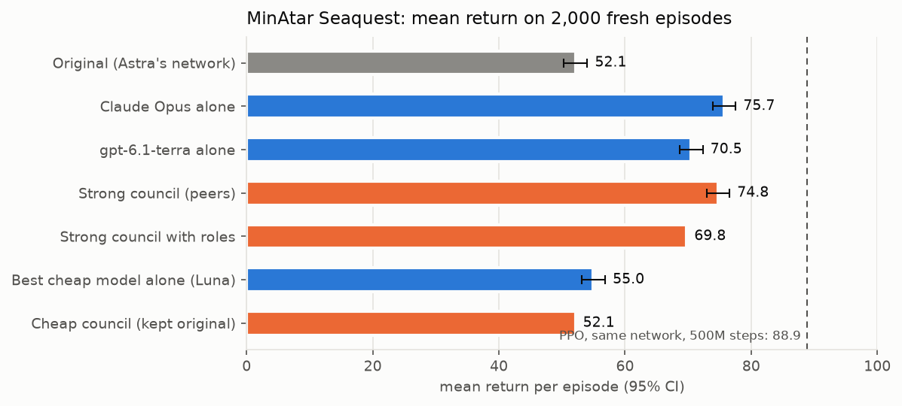

<h1>
  <picture>
    <source media="(prefers-color-scheme: dark)" srcset="docs/logo/logo-dark.svg">
    
  </picture>
</h1>

[](https://github.com/Ahmedn1/wsplab/actions/workflows/ci.yml)
[](CHANGELOG.md)
[](pyproject.toml)
[](LICENSE)
[](CHANGELOG.md)
[](https://github.com/astral-sh/ruff)
[](FINDINGS.md)

Weight-space programming, end to end. An LLM reads a neural network's weights and edits them directly: no gradient
descent, no training pipeline. wsplab runs the whole job, from the baseline to a verdict, and packages the edit as a
small patch anyone can apply to the public base model.

```python
import wsplab

run = wsplab.run(
    "Qwen/Qwen3.5-0.8B",
    note="This model really sucks at math",
    eval="math",
    editor="anthropic:claude-opus-5-5",
    thinking=True,
    budget=25,
)
print(run.verdict, run.patch)
print(run.generate("What is 17 * 23?"))
```

Or the same job from the command line:

```sh
wsplab run --model Qwen/Qwen3.5-0.8B --note "This model really sucks at math" --eval math \
  --editor anthropic:claude-opus-5-5 --thinking --budget 25
```

Based on [*Sparks of Weight-Space Programming*](https://rikiyat.github.io/blog/weight-space-programming/) by Takehi,
Teoh, Zhang and Khattab. wsplab is independent and is not affiliated with or endorsed by the authors.

## What it does

- **Runs everything.** It scores the network, then gives the editor a sandboxed kernel and a budget of forward
  passes. It builds the edit, scores it again on data the editor never saw, and reaches a verdict.
- **Works on any network.** Language models and any PyTorch network: a game policy, a CNN and a diffusion model take
  the same path and differ only in how they are scored.
- **Uses the paper's method.** The same base prompt, turn protocol and editing surface. The editor writes its own
  scripts to inspect the weights, so nothing has to fit in context and nothing is pre-summarized. Replaying the
  authors' sessions reproduces their prompts byte for byte.
- **Tells you when it didn't work.** A hidden evaluation, paired statistics and a same-size random-edit control
  decide the verdict, not the editor. `no_fix_found` is a normal outcome.
- **Makes edits shareable.** A patch is a few small files that rebuild the edited model bit for bit from the public
  base. Patches can be verified, stacked and shared on the Hugging Face Hub.
- **Lets you go as low as you want.** From one call down to raw tensors, including replacing the whole prompt.
- **One editor by default; a council of peers is optional.** Several LLMs can edit side by side and see each other's
  work. The [findings](FINDINGS.md) say when that helps (rarely).

## Install

```sh
pip install wsplab                        # patch tools only: needs just numpy
pip install 'wsplab[torch,kernel]'        # run any PyTorch network
pip install 'wsplab[lm,vllm,eval,hub]'    # language models
wsplab setup                              # builds the sandbox environment, once
wsplab doctor                             # says what this machine can run
```

- **GPU versions:** `constraints-gpu.txt` lists the versions tested together for language models; add
  `-c constraints-gpu.txt`. No CUDA toolkit is needed.
- **Sandbox:** editing sessions run in [bubblewrap](https://github.com/containers/bubblewrap) on Linux.
- **Python:** 3.12 or later.

## Editor API keys

The editor is an LLM you call with your own account. wsplab reads the provider's usual environment variable:

| `--editor` / `editor=` | Key |
|---|---|
| `anthropic:<model>` | `ANTHROPIC_API_KEY` |
| `openai:<model>` | `OPENAI_API_KEY` |
| `openai-chat:<model>` | `OPENAI_API_KEY`, sent to the server at `OPENAI_BASE_URL` |
| `codex:<model>` | None: the [Codex CLI](https://github.com/openai/codex)'s own login (`codex login`) |

```sh
export ANTHROPIC_API_KEY=sk-ant-...
wsplab run ... --editor anthropic:claude-opus-5-5
```

Any OpenAI-compatible provider works through `openai-chat:`. For Gemini, for example:

```sh
export OPENAI_BASE_URL=https://generativelanguage.googleapis.com/v1beta/openai/ OPENAI_API_KEY=<your Gemini key>
wsplab run ... --editor openai-chat:gemini-4-argon
```

In Python, pass keys directly instead, which also lets one council mix providers that would otherwise share
`OPENAI_API_KEY`:

```python
from wsplab.editors import AnthropicEditor, ChatEditor, OpenAIEditor

editors = [AnthropicEditor("claude-opus-5-5", api_key=...),
           OpenAIEditor("gpt-6.1-terra", api_key=...),
           ChatEditor("gemini-4-argon", api_key=..., base_url="https://generativelanguage.googleapis.com/v1beta/openai/")]
```

Keys stay on the host. The sandbox the editor's code runs in starts with an empty environment and no network, so that
code can't read or send them. This holds for the default sandbox, not for `--sandbox none`.

## A network of your own

```python
from wsplab.eval.suites import ArrayScorer

run = wsplab.run(net, build=build_net, description="a small image classifier",
                 note="It confuses cats and dogs", evaluate=ArrayScorer(images, labels),
                 editor="anthropic:claude-opus-5-5", budget=10, max_changed=5_000)
print(run.verdict, run.infer(new_images))
```

`max_changed` is an optional edit budget: `save_edit` refuses edits that would change more entries than that.

## Command line

Every step has a command, and `wsplab <command> --help` lists all its options.

| Command | What it does |
|---|---|
| `wsplab run` | The whole job: baseline, editing session, final evaluation, verdict and patch |
| `wsplab eval` | Score a network, with or without a patch |
| `wsplab infer` | Run a network, with or without a patch |
| `wsplab patch ...` | Create, apply, verify, inspect, stack and share patches |
| `wsplab session ...` | Be the editor yourself, step by step (for coding agents) |
| `wsplab setup`, `wsplab doctor` | Build the sandbox once; check what this machine can run |

### Edit a language model

`--eval math` is the paper's task: the editor practises on the paper's released problems, and the verdict comes from
MATH-500, which the editor never sees.

```sh
wsplab run --model Qwen/Qwen3.5-0.8B --note "This model really sucks at math" \
  --eval math --samples 4 --limit 200 --thinking \
  --editor anthropic:claude-opus-5-5 --budget 25 --out runs/qwen-math
```

It ends by printing the verdict and where everything went:

```text
verdict: confirmed            # or not_significant, regressed, no_fix_found, unmeasured
  ...                         # the reasons for the verdict
patch: runs/qwen-math/result/patch
report: runs/qwen-math/report.md
```

For a task of your own, give a practice set and a held-out set as `.jsonl` files, one
`{"id": ..., "problem": ..., "answer": ...}` per line. `--grader` is `exact`, `math`, `choice` or `regex:<pattern>`:

```sh
wsplab run --model Qwen/Qwen3.5-0.8B --practice practice.jsonl --eval heldout.jsonl --grader exact \
  --note "It answers in English when asked in French" --editor openai:gpt-6.1-terra --budget 15
```

### Edit any PyTorch network

Give the weights, a way to build the network, and `.npz` files holding arrays named `inputs` and `targets`:

```sh
wsplab run --model net.safetensors --build model.py:build --description "a small image classifier" \
  --note "It confuses cats and dogs" --practice practice.npz --eval heldout.npz \
  --editor anthropic:claude-opus-5-5 --budget 10 --max-changed 5000 --out runs/cats
```

- **`--build`:** `path/model.py:function`, where the function returns the `nn.Module`. A plain MLP can be written
  inline instead, such as `mlp:784,128,10:relu`.
- **`--description`:** completes the sentence "You are given the weights of ...".
- **Limits:** `--max-changed` caps how many weight entries the edit may change, and `--frozen <tensor>` (repeatable)
  keeps a tensor unchanged.
- **Scoring:** `--metric accuracy` (the default) or `neg_mse` for regression.
- **No held-out set:** `--no-eval` accepts an `unmeasured` verdict.

### Check the result yourself

`eval` and `infer` run the base model, or the base model with a patch applied:

```sh
# any network
wsplab eval  --model net.safetensors --build model.py:build --data heldout.npz
wsplab eval  --model net.safetensors --build model.py:build --data heldout.npz --patch runs/cats/result/patch
wsplab infer --model net.safetensors --build model.py:build --patch runs/cats/result/patch \
  --input batch.npy --out predictions.npy

# a language model
wsplab eval  --model Qwen/Qwen3.5-0.8B --suite math --limit 200 --patch runs/qwen-math/result/patch
wsplab infer --model Qwen/Qwen3.5-0.8B --patch runs/qwen-math/result/patch --prompt "What is 17 * 23?"
```

### Choose the editor

`--editor` takes `anthropic:<model>`, `openai:<model>`, `codex:<model>`, or `openai-chat:<model>` for any
OpenAI-compatible server (see [An open-source editor](#an-open-source-editor)). [Editor API keys](#editor-api-keys)
says where each one finds its key.

Repeat `--editor` for a council of peers. A council needs a spending limit, `--max-tokens` or `--max-usd`. A dollar
limit needs a price for each editor, in dollars per million input and output tokens. The prices below are examples;
use your provider's:

```sh
wsplab run --model net.safetensors --build model.py:build --description "a small image classifier" \
  --practice practice.npz --eval heldout.npz --budget 8 \
  --editor anthropic:claude-opus-5-5 --editor openai:gpt-6.1-terra \
  --max-usd 10 --price anthropic:claude-opus-5-5=5,20 --price openai:gpt-6.1-terra=1,5
```

From the command line, councils work on PyTorch networks. Use the Python API for a council on a language model.

### Be the editor

A coding agent, or you, can do the editor's job one step at a time. Each step is checked against the same rules and
budget as an LLM editor:

```sh
wsplab session start --folder s1 --model net.safetensors --build mlp:2,4,2:relu \
  --description "a two-class classifier" --note "It answers backwards" \
  --practice practice.npz --eval heldout.npz --budget 10
wsplab session exec s1 --file inspect.py --why "first, look at the weights"
wsplab session forward s1 '{"model": "both"}' --why "measure the edit"
wsplab session finish s1 "What I changed, the evidence, and why it should help."
```

`finish` prints the verdict. `wsplab session brief s1` prints the latest message, and `/work` in the kernel is
`s1/run/work` on the host.

## An open-source editor

Any model behind an OpenAI-compatible chat server can be the editor. The protocol is plain text, so no tool calling
is needed:

```sh
vllm serve Qwen/Qwen3-32B --max-model-len 65536      # sessions need long context
export OPENAI_BASE_URL=http://localhost:8000/v1 OPENAI_API_KEY=local
```

```sh
wsplab run --model net.safetensors ... --editor openai-chat:Qwen/Qwen3-32B
```

```python
run = wsplab.run(net, ..., editor="openai-chat:Qwen/Qwen3-32B")
# or, to mix servers in one council: ChatEditor("Qwen/Qwen3-32B", base_url="http://host:8000/v1", api_key="local")
```

For limits on local models, which have no prices, use `--max-tokens` or `Spending(max_tokens=...)`. Tested end to
end with a vLLM-served Qwen3.5-0.8B: the session ran, but a model that small couldn't do the job. Expect to need a
strong open model.

## Progress and logs

A run says what it is doing as it goes: which step it is on, how far generation has got and how long is left, and one
line per editor turn. The same lines go to `run.log` in the run's folder, so a run in the background can be followed
with `tail -f`:

```text
09:12:03  MATH-500: 500 held-out items x 4 answers, up to 32,768 new tokens each with thinking; 14,744 practice items
09:12:03  each evaluation generates up to 65.5M tokens; this run has up to 3 (baseline, edited model, random-edit control)
09:41:17  baseline evaluation: 160/2,000 answers (8%), 1,310 tokens/s, about 5h 36m left
...
15:02:44  turn 7: forward pass 2/25: model both, items 64, original 0.172, edited 0.25, difference +0.078 ± 0.03, 9m 12s | ...
```

- **Quieter:** `quiet=True` in Python, or `wsplab -q run ...`, keeps only `run.log`. `wsplab -v` prints more detail.
- **Your own logging:** messages go to the `wsplab` logger. If you have set up logging, they go to your handlers
  instead of being printed.
- **Nothing from the evaluation** goes into a message: only counts, scores and timings.
- **Interrupted?** The last line says how to resume.

## A council of peers (optional)

```python
from wsplab.editors import Spending

found = wsplab.search(net, build=build_net, description="a small image classifier", practice=practice,
                      evaluate=heldout, editors=["anthropic:claude-opus-5-5", "openai:gpt-6.1-terra"],
                      shared=True, spending=Spending(max_usd=10, prices={...}))
```

Each peer edits its own copy and sees the others' work after every step. The best candidate on a held-out selection
set wins, and the original is kept if none beats it. On the command line, repeat `--editor`. See
[docs/council.md](docs/council.md).

## Patches

```sh
wsplab patch apply patch/ --base Qwen3.5-0.8B/ --out edited/
wsplab patch verify patch/ --base Qwen3.5-0.8B/
wsplab patch pull user/some-patch --out patch/
```

A patch's hashes prove what it is and that it fits the base model. They don't prove it is safe or that its claims
hold.

## With a coding agent

`skills/wsplab` is an agent skill. It teaches an agent to launch runs, or to act as the editor itself through
`wsplab session`. Copy it into your agent's skills folder.

## Findings

We ran 11 experiments with real editors on one laptop. **[Read the findings](FINDINGS.md)**, with charts:

- **wsplab reproduces the paper's measurements:** the released patches rebuild bit for bit and the prompts replay
  byte for byte.
- **Editing works on steerable behaviour:** on the paper's Seaquest policy, strong editors raised the score from 52
  to 76 with 32 weights changed. It doesn't work on missing capability (Gemma math, multilingual math).
- **A two-line scripted recipe** matched or beat LLM editors on Spurious ImageNet.
- **Councils lift their weakest member** but didn't beat the strongest on any natural task. Cheap councils and fixed
  roles did worse.

<picture>
  <source media="(prefers-color-scheme: dark)" srcset="docs/figures/seaquest-dark.png">
  
</picture>

Everything needed to reproduce them, including code, plans, result files and commands, is in
[`experiments/`](experiments/).

## How wsplab compares

Several weight-space programming projects appeared in November 2026. As of 8 November, from their public READMEs:

| | wsplab | [dspy-wsp](https://pypi.org/project/dspy-wsp/) | [weightspace](https://github.com/leofmarciano/weightspace) | [wsp-kit](https://github.com/AuremHQ/weight-space-programming) | [WSP-toolkit](https://github.com/ZeroTang05/WSP-toolkit) |
|---|---|---|---|---|---|
| LLM writes the edits | yes | yes (a DSPy LM) | yes | no (a numerical estimator) | via tool calls |
| Language models | yes (vLLM, HF) | yes (vLLM, HF, MLX) | yes | small LLMs (≤ 3B) | Qwen3, Llama |
| Any PyTorch network | yes | decision models | not stated | no | no |
| Sandboxed kernel | bubblewrap | bubblewrap | Python sandbox | not stated | not stated |
| Budgeted forward-pass tool | yes | yes | not stated | no | no |
| Hidden evaluation + paired stats + random control | yes | holdout + valset, no control | not stated | metric thresholds | separate test set |
| Patches rebuilt bit for bit from the base | yes, plus Hub, stacking | yes | checkpoints | edited folder | replayable patches |
| Paper fidelity checks (byte-for-byte replay) | yes | no | no | no | no |
| Multiple editors | peers (optional) | population search (GEPA) | no | no | no |
| CLI and agent skill | yes, plus agent-as-editor sessions | CLI | no | CLI, skill, MCP | MCP |

dspy-wsp is the closest in scope, and it adds things wsplab lacks: DSPy integration and a population search over
candidate edits. Other related projects are agent skills
([di37](https://github.com/di37/weight-space-programming-skill),
[GriMReapeR-666](https://github.com/GriMReapeR-666/weight-space-programming-skill)), a research harness for coding
agents ([mfaseehuddin/wsp](https://github.com/mfaseehuddin/wsp)) and a browser version
([webWeightSpace](https://github.com/vishalmysore/webWeightSpace)). None of their code is used here.

## Read more

- [Concepts](docs/concepts.md): kinds, modes, access and control levels.
- [Patches](docs/patches.md): the format and how to share one.
- [Councils of peers](docs/council.md).
- [Fidelity to the paper](docs/fidelity.md): what is the authors' work, what is reconstructed, and what differs.
- [Findings](FINDINGS.md) and [experiments](experiments/).
- [Changelog](CHANGELOG.md).

## Citing

See [CITATION.cff](CITATION.cff). Please also cite the paper.

## License

MIT. Prompt text derives from the authors' release under CC BY 4.0: see [NOTICE](NOTICE).
